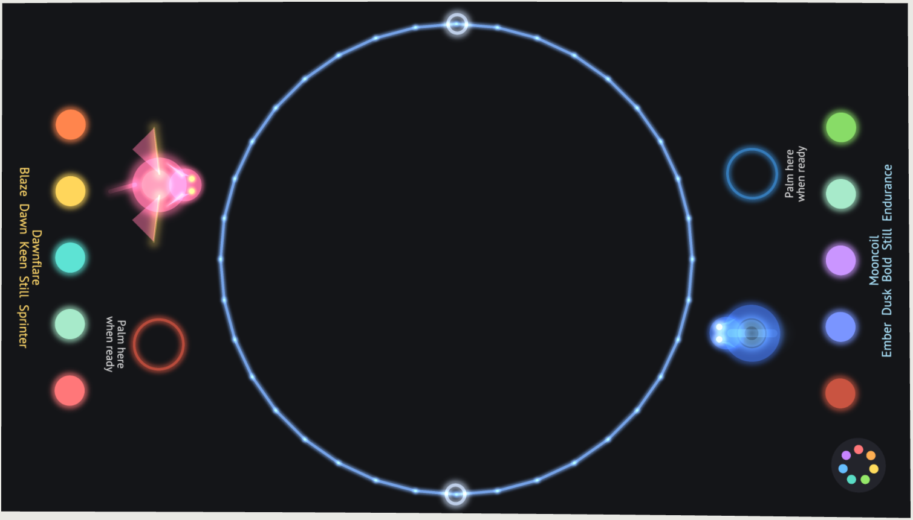
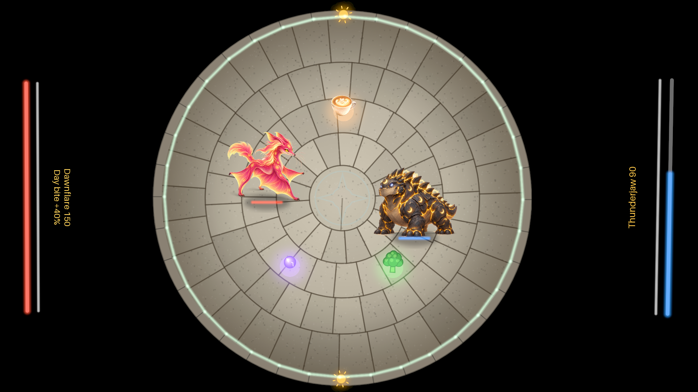

# Creature Arena on the Daydream table

This branch (`browser-game`) also has the full browser game in `browser-game/`, with the
creatures' paintings, walk animations, co-op Hatchling Expedition, computer opponent and
network play. To run it: `cd browser-game`, `npm install`, `npm run dev`, then open the
link it prints. Its own README has the details.

Creature Arena's fight, moved to Daydream (Adrian Cipriani's projector and camera table,
built on Folk). Two players stand at the short ends of the table. Their creatures fight in
a ring of light in the middle, and everything is played with hands. It is a Daydream app
(`dream new game` layout) for the SDK at UrsprungLabs/daydream-sdk. The browser game it
comes from is in Genome Wrapped (`games/creature-arena`).





## How to play

**Pick your creature.** Your end of the table shows five coloured switches, one per gene:
Flame, Time, Senses, Spark and Muscles. Pinch a switch, or hold a fingertip on it, to flip
it. Your creature and its genes show beside the switches. When you're happy, hold your
open palm on the ring that says "Palm here". The fight counts down once both players are
ready.

**Fight.**
- Your creature runs towards your hand.
- Pinch to bite. The bite aims at the other creature when it's close.
- Make a fist to sprint. How long you can sprint depends on your muscle type.
- Your health and stamina bars run along your end of the table.

The first creature to empty the other's health wins. After the win the table goes back to
the pick screen, keeping both players' choices.

**What the genes do** (the same as the browser game):

| Power up | One version | The other version |
|---|---|---|
| Coffee (Flame) | Blaze: a speed boost for 5 s | Ember: frozen with the jitters for 1.5 s |
| Bitter greens (Senses) | Bold: heals 10 | Keen: reels out of control for 1.5 s |
| Energy orb (Spark) | Crackling: the next bite is a lightning dash | Still: a shield that blocks the next hit |

- **Keen** creatures sense a power up a second before it appears (a faint marker), and
  reach further to grab one.
- **Day and night** take turns. Dawn creatures bite 40% harder by day, Dusk creatures at
  night. A sun or a moon beside the ring shows which it is.

The game never sees DNA: a creature is only its name and four genes, as in the browser
game.

## What it's made of

- `creaturearena.folk`: the whole game. The rules are the browser game's (`src/sim.ts`)
  with the same numbers (`src/config.ts`), written in C for speed. It draws as light, one
  draw per kind of light per frame.
- `app.tcl`: the app's manifest.
- `test/test-creaturearena.folk`: a headless test. It checks that a fingertip flips a gene,
  both palms start the fight, a hand leads its creature, a pinch bites, each power up does
  what the genes say, and the last bite wins.
- `test/scene.tcl`: the scene `dream budget` measures, the busiest moment of a fight.

## Checked

With the SDK's own tools, on Folk built from the SDK:

- `dream check`: no errors or warnings.
- `dream test`: passes.
- `dream budget` against the reference table: 1.8 ms CPU a frame (budget 2), 0.08 of a
  core (budget 0.25), about 1.9 ms GPU a frame (budget 2, an estimate), first light in
  about 10 ms.
- `dream studio`: the previews above are from the emulated table.

Not yet checked: playing it on the real table with real hands. Tracking noise, the
cameras' delay and real light can only be checked there (`dream zap`).

## Running it

From a checkout of daydream-sdk:

```
export PATH=$PWD/sdk/bin:$PATH
cd path/to/creature-arena-daydream
dream check
dream test
dream studio      # the emulated table in your browser: Games, then Creature Arena
dream zap         # only to send it to a real table
```

## Known limits

- **Creatures are drawn as light, not as their paintings.** Daydream's public drawing
  statements are glowing dots, beams and triangles. Each creature gets its painting's
  colours and its main features (wings, ears, plates, spines, horns, a coil, a plume, a
  mane), but not the painting itself. If Daydream makes image drawing public, the painted
  creatures and their walk cycles could go on the table instead.
- Two players only, at the short ends. No computer opponent.
- No creature code entry yet: genes are picked with the switches.
