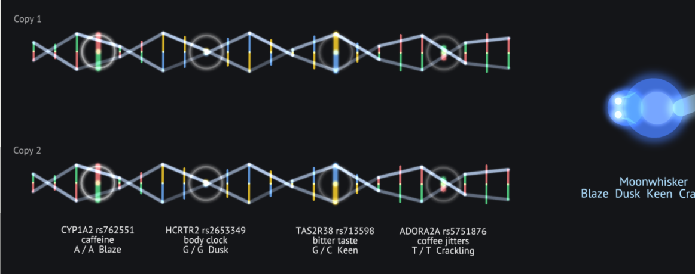
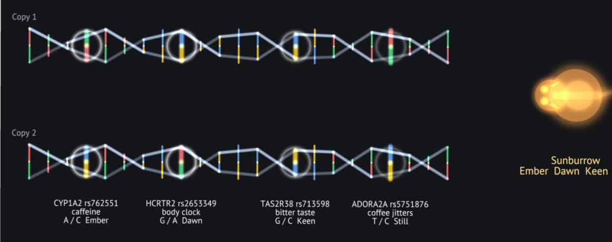

# DNA Helix

A Daydream table app. Your two copies of a stretch of DNA float across the table as two
turning double helixes of light. The four letters that decide a Genome Wrapped creature
are lit up on them, and the creature they make stands beside them. Change a letter and the
creature changes.




## How to use it

- **Show it:** the table menu's DNA Helix button (or `Wish dnahelix is shown`).
- **Swap a letter:** pinch a glowing rung, or hold a fingertip on it for half a second.
  The letter changes on that copy, and so does the label below it.
- **Watch the creature:** when the letters change its genes, it changes, with a flash
  and a little chord.
- **Unzip:** pinch anywhere else on a helix and pull away from it. It opens up there, the
  ladder lies flat and the base pairs come apart (A with T, G with C). Let go and it
  zips back.

## What it teaches

The four lit letters are the real SNPs behind the creatures, with the same rules as Genome
Wrapped (`app/src/engine/archetype.ts`):

| Gene | SNP | What it does | Rule |
|---|---|---|---|
| CYP1A2 | rs762551 | caffeine clearance | A/A = Blaze, any C = Ember |
| HCRTR2 | rs2653349 | body clock | any A = Dawn, G/G = Dusk |
| TAS2R38 | rs713598 | bitter taste | any G = Keen, C/C = Bold |
| ADORA2A | rs5751876 | coffee jitters | T/T = Crackling, any C = Still |

- **Two copies:** everyone has two copies of each gene, one from each parent. That's
  why there are two helixes.
- **Dominance:** some traits need the letter on both copies (A/A, T/T), and some need it
  on only one (any A, any G). You find this out by swapping a letter on one copy and
  seeing whether the creature changes.
- **Base pairing:** unzipping shows that A always pairs with T, and G with C.

It only ever uses these creature letters, never anyone's real DNA. The other letters on
the helixes are filler.

## Checked

With Adrian's SDK (daydream-sdk), on Folk built from it:

- `dream check`: no errors or warnings.
- `dream test`: passes. The test checks that it starts as Moonwhisker, that a fingertip on
  copy 2's CYP1A2 rung swaps A for C and turns the creature into Shadepounce, and that a
  pinch pulled away unzips a helix and lets it zip back.
- `dream budget`: within the table's budgets, but only just on CPU (about 1.9 to 2.0 ms a
  frame against 2 ms). GPU about 1.6 ms of 2 ms.
- `dream studio`: the previews above are from the emulated table.

Not yet tried on the real table.

## Running it

From a checkout of daydream-sdk:

```
export PATH=$PWD/sdk/bin:$PATH
cd path/to/creature-arena-daydream/dna-helix
dream test
dream studio      # then DNA Helix in the top strip, Show
```

To have both apps in the Studio at once, run `dream studio . dna-helix` from the repo's
top folder.
